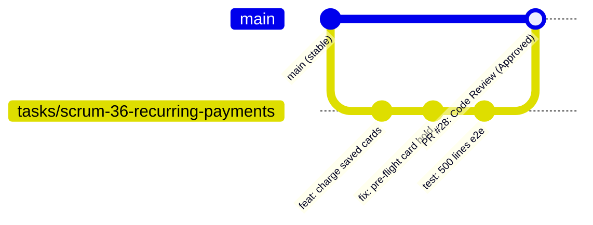

# «Окно в Европу» (Apple Gift Cards & Subscriptions Backend)

[](https://fastapi.tiangolo.com)
[](https://www.python.org/)
[-D71F00?logo=sqlalchemy&logoColor=white)](https://www.sqlalchemy.org/)
[](https://www.postgresql.org/)
[](https://alembic.sqlalchemy.org/)
[](https://www.docker.com/)

Серверный бэкенд платформы для безопасной покупки подарочных карт Apple Gift Cards и регулярной ежемесячной автодоставки по подписке с безакцептным списанием через платёжный шлюз ЮKassa.

---

## 🚀 Быстрый старт (Local Development)

### Требования
* **Python 3.12+**
* **Docker & Docker Compose**
* **Git**

### Запуск проекта с нуля за 1 минуту

```bash
# 1. Клонирование репозитория
git clone https://github.com/hundlervpn/applegiftcards.git
cd applegiftcards

# 2. Создание и активация виртуального окружения
python3 -m venv .venv
source .venv/bin/activate       # Linux / macOS
# .venv\Scripts\Activate.ps1    # Windows PowerShell

# 3. Установка зависимостей
pip install -r requirements.txt

# 4. Настройка переменных окружения
cp .env.example .env

# 5. Поднятие базы данных и API в Docker одной командой
docker compose up -d --build

# Либо запуск PostgreSQL в Docker и локальный запуск приложения:
# docker compose up -d postgres
# alembic upgrade head
# python scripts/seed_data.py
# uvicorn app.main:app --reload
```

### Проверка работоспособности
* **Healthcheck:** [http://localhost:8000/health](http://localhost:8000/health) — возвращает статус подключения к базе данных (`"database": "ok"`).
* **Swagger UI (OpenAPI 3.1):** [http://localhost:8000/docs](http://localhost:8000/docs) — интерактивная документация всех эндпоинтов с авторизацией через кнопку **Authorize** (`BearerAuth`).
* **ReDoc:** [http://localhost:8000/redoc](http://localhost:8000/redoc).

Остановка контейнеров:
```bash
docker compose down
```
*(Данные сохраняются в изолированном Docker Volume `postgres_data`).*

---

## 🧪 Запуск автотестов

Проект сопровождается набором интеграционных и сквозных тестов (pytest, pytest-asyncio, httpx):

```bash
# Запуск полного тестового набора
pytest

# Запуск тестов конкретного домена (например, рекуррентные списания)
pytest tests/test_recurring_payments.py -v
```

---

## 🏛️ Архитектура проекта

Кодовая база построена по строгой трёхзвенной **слоистой архитектуре (Layered Architecture)** с изоляцией ответственности:

```
app/
├── api/                  # Слой контроллеров (HTTP / REST)
│   ├── v1/               # Версионированные роуты: auth, me, orders, catalog, admin, webhooks
│   ├── openapi.py        # OpenAPI теги, примеры ответов, схемы ошибок
│   └── background_tasks.py # Обертки фоновых задач FastAPI
├── services/             # Чистая бизнес-логика и сценарии (Use Cases)
│   ├── recurring_payments.py # Списание подписок, hold инвентаря, защита от дрифта биллинга
│   ├── order_fulfillment.py  # Выполнение заказов и выдача карт по вебхукам
│   ├── crypto.py         # Симметричное шифрование кодов Fernet (AES-128-CBC)
│   ├── tokens.py         # Выпуск и валидация JWT access/refresh токенов
│   └── payments.py       # Интеграционный клиент ЮKassa API
├── repositories/         # Слой доступа к данным (SQLAlchemy 2.0 async)
│   ├── inventory.py      # Атомарный захват карт (FOR UPDATE SKIP LOCKED)
│   ├── subscriptions.py  # Выборка due-подписок и блокировки (FOR UPDATE populate_existing)
│   └── orders.py         # Постраничная загрузка заказов и персистентность
├── models/               # SQLAlchemy Declarative Entities (схема БД)
├── schemas/              # Входные и выходные Pydantic v2 DTOs
├── dependencies.py       # FastAPI Dependency Injection (CurrentUser, BearerAuth)
├── db/                   # Фабрика подключений и сессий AsyncSession
└── money.py              # Валютный тип Rub (Decimal) и конвертеры для кассы
```

> 📖 **Подробное архитектурное обоснование:**  
> Читайте полный документ [**`docs/architecture.md`**](docs/architecture.md) с объяснением:
> * Почему выбрана модель `api -> services -> repositories -> models`, а не Fat Controllers или ActiveRecord.
> * Как гарантируется финансовая точность без `float` (Money Pattern).
> * Как организован Pre-flight lock инвентаря до отправки запроса в платёжный шлюз.
> * Как исключаются race conditions и дедлоки при одновременных покупках.

---

## 🌿 Командный Git-процесс и защита ветки `main`

Для обеспечения стабильности основной ветки и соблюдения инженерной дисциплины в команде действует строгий регламент разработки:



### 1. Защита ветки `main` (Protected Branch)
* **Прямой `git push` в ветку `main` категорически запрещён.**
* Все изменения попадают в `main` **исключительно** через Pull Requests (PR).
* Вливание PR разрешается только после прохождения ревью кода техлидом / ревьюером (`✅ Approve`).

### 2. Регламент именования веток
Каждая функциональная задача разрабатывается в отдельной ветке, ответвлённой от актуального `origin/main`.  
Имя ветки формируется строго по шаблону:
$$\text{tasks/scrum-}<\text{ID задачи}>-<\text{краткое-описание-kebab-case}>$$

**Примеры:**
* `tasks/scrum-28-subscription-models`
* `tasks/scrum-36-recurring-payments`
* `tasks/scrum-45-openapi-auth-me`
* `tasks/scrum-47-docker-compose-api`

### 3. Обязательный процесс Code Review (`code-review-skill`)
Каждый открытый Pull Request проходит комплексное 4-фазное ревью:
1. **Phase 1: Context Gathering & Diff Metrics:**
   - Анализ диффа с помощью автоматического анализатора:
     ```powershell
     git diff origin/main...<branch> | python -X utf8 pr-analyzer.py --stats
     ```
   - Оценка размера PR (ориентир: $\le 400$ строк логики) и зон повышенного риска (авторизация, платежи).
2. **Phase 2: High-Level Review:**
   - Сверка с целевой архитектурой: соблюдение слоёв `api -> services -> repositories -> models`.
   - Анализ производительности SQL-запросов, проверка отсутствия проблемы N+1 и дедлоков.
3. **Phase 3: Line-by-Line Review & Quality Checklists:**
   - Построчная проверка чек-листов FastAPI (DI через `Depends`, Pydantic v2 валидаторы, корректность `async/await`, контекст транзакций).
   - Reuse Audit: переиспользование существующих доменных утилит (`app/money.py`, репозиториев) и исключение дублирования.
   - Concurrency Audit: исключение уязвимостей состояния гонки (TOCTOU) через строчные блокировки `FOR UPDATE`.
4. **Phase 4: Summary & Decision:**
   - Оформление отчёта со стандартными метками приоритета:
     - 🔴 `[blocking]` — критическая ошибка, обязательна к исправлению до слияния.
     - 🟡 `[important]` — важная рекомендация по архитектуре или надёжности.
     - 🟢 `[nit]` — косметическое замечание.
     - 💡 `[suggestion]` — предложение на будущее развитие.
     - 🎉 `[praise]` — похвала за грамотное инженерное решение.
   - Итоговый вердикт: `✅ Approve`, `💬 Comment`, или `🔄 Request Changes`.

### 4. Критерии готовности задачи (Definition of Done — DoD)
Задача считается закрытой («Done»), только если:
1. **Код влит в `main`:** PR создан, отрецензирован по стандарту и чисто влит без конфликтов.
2. **Сквозной сценарий работает:** функционал проверен от HTTP-запроса до состояния БД и сторонних сервисов без регрессий.
3. **Автотесты и документация:** все тесты `pytest` проходят успешно, эндпоинты задокументированы в Swagger UI (`/docs`), `.env.example` актуализирован.

---

## 👥 Роли и зоны ответственности в команде

Команда проекта «Окно в Европу» состоит из **6 участников**: 1 техлид, 2 системных аналитика и 3 разработчика.

| Роль | Участник | Зона ответственности и артефакты |
| :--- | :--- | :--- |
| **Техлид (Lead Developer)** | **Шепелёв Константин** | Архитектура репозитория, правила веток и Git-процесс, проведение Code Review всех PR, деплой на стенд и координация команды. |
| **Системный аналитик** | **Логачев Евгений** | Исследование рынка, модели мошенничества и антифрод, правила возврата и гарантии кодов, экономическая модель, Vision и пользовательские сценарии. |
| **Системный аналитик** | **Чертов Михаил** | Контроль качества кодов, приёмка партий, спецификация учёта поставщиков, DoR / DoD и приёмочное тестирование инкрементов. |
| **Разработчик (Backend)** | **Кузьменко Степан** | Поток А: Рекуррентные подписки, безакцептные списания ЮKassa, планировщик биллинга, шифрование кодов Fernet, архитектура БД и миграции. |
| **Разработчик (Backend)** | **Зарецкий Михаил** | Поток B/C: Авторизация JWT/bcrypt, личный кабинет пользователя (`/me/orders`, `/me/subscriptions`), админ-панель пакетной загрузки карт. |
| **Разработчик (Backend / DevOps)** | **Чубаров Егор** | Интеграционный клиент ЮKassa API, вебхуки платежей, идемпотентность, Docker Compose, автотесты и окружение локального запуска. |

---

## 📄 Лицензия и документация проекта
* Архитектурное руководство: [docs/architecture.md](docs/architecture.md)
* Схема базы данных: [docs/schema.sql](docs/schema.sql) и [docs/schema.dbml](docs/schema.dbml)
* Спецификации решений (SDD): [docs/sdd-scrum-35-save-payment-method.md](docs/sdd-scrum-35-save-payment-method.md), [docs/sdd-scrum-36-recurring-payments.md](docs/sdd-scrum-36-recurring-payments.md), [docs/sdd-scrum-37-billing-scheduler.md](docs/sdd-scrum-37-billing-scheduler.md), [docs/sdd-scrum-38-dunning-management.md](docs/sdd-scrum-38-dunning-management.md)
