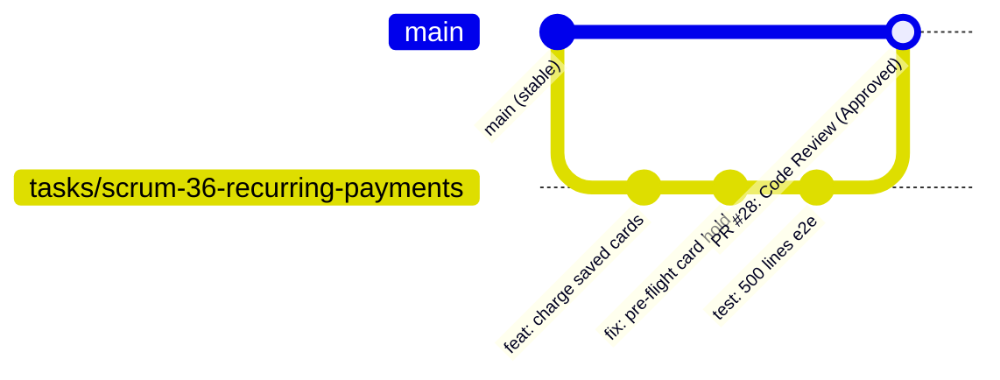

# «Окно в Европу» (Apple Gift Cards & Subscriptions Backend)

[](https://fastapi.tiangolo.com)
[](https://www.python.org/)
[-D71F00?logo=sqlalchemy&logoColor=white)](https://www.sqlalchemy.org/)
[](https://www.postgresql.org/)
[](https://alembic.sqlalchemy.org/)
[](https://www.docker.com/)

Серверный бэкенд платформы для безопасной покупки подарочных карт Apple Gift Cards и регулярной ежемесячной автодоставки по подписке с безакцептным списанием через платёжный шлюз ЮKassa.

---

## 🚀 Быстрый старт (Local Development)

### Требования
* **Python 3.12+**
* **Docker & Docker Compose**
* **Git**

### Запуск проекта с нуля за 1 минуту

```bash
# 1. Клонирование репозитория
git clone https://github.com/hundlervpn/applegiftcards.git
cd applegiftcards

# 2. Создание и активация виртуального окружения
python3 -m venv .venv
source .venv/bin/activate       # Linux / macOS
# .venv\Scripts\Activate.ps1    # Windows PowerShell

# 3. Установка зависимостей
pip install -r requirements.txt

# 4. Настройка переменных окружения
cp .env.example .env

# 5. Поднятие базы данных и API в Docker одной командой
docker compose up -d --build

# Либо запуск PostgreSQL в Docker и локальный запуск приложения:
# docker compose up -d postgres
# alembic upgrade head
# python scripts/seed_data.py
# uvicorn app.main:app --reload
```

### Проверка работоспособности
* **Healthcheck:** [http://localhost:8000/health](http://localhost:8000/health) — возвращает статус подключения к базе данных (`"database": "ok"`).
* **Swagger UI (OpenAPI 3.1):** [http://localhost:8000/docs](http://localhost:8000/docs) — интерактивная документация всех эндпоинтов с авторизацией через кнопку **Authorize** (`BearerAuth`).
* **ReDoc:** [http://localhost:8000/redoc](http://localhost:8000/redoc).

Остановка контейнеров:
```bash
docker compose down
```
*(Данные сохраняются в изолированном Docker Volume `postgres_data`).*

---

## 🧪 Запуск автотестов

Проект сопровождается набором интеграционных и сквозных тестов (pytest, pytest-asyncio, httpx):

```bash
# Запуск полного тестового набора
pytest

# Запуск тестов конкретного домена (например, рекуррентные списания)
pytest tests/test_recurring_payments.py -v
```

---

## API-коллекции (SCRUM-30)

Одинаковый сценарий доступен в двух форматах:

| Формат | Файлы |
| --- | --- |
| Postman Collection v2.1 | [`postman/awe_api_collection.json`](postman/awe_api_collection.json) |
| Окружение Postman | [`postman/local.postman_environment.json`](postman/local.postman_environment.json) |
| Bruno | [`bruno/`](bruno/), окружение `local` |

В каждой коллекции 28 запросов с проверками и сохранёнными примерами ответов: health, OpenAPI, Swagger, ReDoc, каталог, register/login/refresh, заказ, вебхук, личный кабинет, отмена подписки, загрузка кодов и статистика. Включены проверки 400/401/403/409 и повторной обработки вебхука и отмены.

### Подготовка тестового стенда

Используйте отдельную тестовую БД. Прогон создаёт двух пользователей, загружает два **демонстрационных, неактивируемых кода**, покупает одну карту и отменяет созданную подписку. Данные сохраняются после ручного прогона. Одновременно менять остатки на этом стенде нельзя: финальная проверка сравнивает их с начальным снимком.

1. Запустите API и миграции по инструкции выше.
2. Настройте `FERNET_KEY`, `ADMIN_API_TOKEN`, SMTP для тестового ящика и **тестовые** `YOOKASSA_SHOP_ID` / `YOOKASSA_SECRET_KEY` на бэкенде.
3. На пустой БД выполните `python scripts/seed_data.py`, чтобы появились цены. Скрипт также создаёт начальные тестовые карты.
4. Заполните локальное окружение коллекции. Ключи ЮKassa должны относиться к тому же тестовому магазину, который настроен на бэкенде.

| Переменная | Назначение |
| --- | --- |
| `baseUrl` | Адрес бэкенда без `/api/v1`, по умолчанию `http://127.0.0.1:8000` |
| `adminToken` | Значение `ADMIN_API_TOKEN` бэкенда |
| `authToken`, `refreshToken` | Заполняются автоматически при register/login/refresh |
| `testOrderId`, `testSubscriptionId` | Заполняются из ответов API |
| `testEmail` | Пустое значение создаёт уникальный email на каждый прогон; можно указать свой тестовый адрес |
| `testPassword` | Пароль создаваемых тестовых пользователей; пример `DemoPass123` |
| `testNominalUsd` | Номинал из таблицы `prices`, по умолчанию `10` |
| `yookassaBaseUrl` | `https://api.yookassa.ru/v3`; режим тестирования определяется ключами магазина |
| `yookassaShopId`, `yookassaSecretKey` | Ключи тестового магазина для чтения состояния платежа |
| `paymentMaxPolls` | Максимум запросов ожидания оплаты, по умолчанию `90` |

В файлах секреты пустые. В Postman задавайте их в своём окружении, в Bruno — в Secret Variables или через параметры CLI. Bruno сохраняет динамические токены и идентификаторы только в памяти через `bru.setVar`, без записи в файлы коллекции. Не коммитьте заполненные окружения или отчёты с токенами и кодами.

### Импорт и ручной прогон

**Postman:** Import → выберите оба JSON из `postman/` → выберите окружение `AWE local — test only` → заполните секреты → Run collection. Запускайте всю коллекцию в исходном порядке с задержкой **1000 мс** между запросами.

**Bruno:** Open Collection → выберите папку `bruno/` → выберите окружение `local` → заполните секреты → Run Collection с задержкой **1000 мс**. Дополнительные npm-библиотеки и Developer Mode для скриптов не нужны.

Сценарий:

1. `01 Health` создаёт уникальные значения прогона и очищает предыдущие временные токены. Затем проверяются документация, каталог и авторизация.
2. Коллекция сохраняет начальные остатки и загружает два демо-кода.
3. `11 Create order` создаёт первую покупку подписки через `/orders/one-time` с `is_subscription=true`, сохраняет `testOrderId` и `paymentUrl`.
4. **Откройте `paymentUrl` из ответа/консоли и завершите тестовую оплату.** Для подписки подтвердите сохранение карты. Коллекция сама не вводит платёжные данные и не оплачивает заказ.
5. `12 Wait for test payment` находит заказ в ЮKassa, обрабатывает пагинацию и ждёт `succeeded`. Если лимит ожидания исчерпан, прогон завершается ошибкой; увеличьте `paymentMaxPolls` или продолжите вручную с запроса 12 после оплаты.
6. Из проверенного объекта платежа собирается webhook. Бэкенд повторно сверяет его с ЮKassa. Повтор webhook должен вернуть 200 и оставить тот же единственный код в истории заказа.
7. Проверяются ЛК, маска карты, отмена подписки и её повтор, финальные остатки и запрет доступа к чужой подписке.

Публичный сайт для ручного запуска коллекции не нужен. Если хотите получать автоматические уведомления ЮKassa, настройте публичный HTTPS webhook URL через тестовый стенд или туннель. Ручной повтор webhook коллекцией безопасен по идемпотентности. HMAC-заголовок не добавляется: подлинность проверяется запросом бэкенда к API ЮKassa.

Для отдельной ручной проверки обычного разового заказа скопируйте запрос 11 и задайте `is_subscription=false`. Полный сценарий коллекции проверяет именно первую оплату подписки и требует `true`.

### Запуск через CLI

Для CLI нужен Node.js 22+. Версии раннеров зафиксированы в командах. Секреты передайте через переменные процесса `ADMIN_API_TOKEN`, `YOOKASSA_SHOP_ID`, `YOOKASSA_SECRET_KEY`; не подставляйте реальные ключи в файлы репозитория.

Из корня репозитория, Postman через Newman:

```bash
npx --yes newman@6.2.3 run postman/awe_api_collection.json \
  -e postman/local.postman_environment.json \
  --env-var "adminToken=$ADMIN_API_TOKEN" \
  --env-var "yookassaShopId=$YOOKASSA_SHOP_ID" \
  --env-var "yookassaSecretKey=$YOOKASSA_SECRET_KEY" \
  --delay-request 1000 --bail
```

Bruno:

```bash
cd bruno
npx --yes @usebruno/cli@4.3.0 run --env local \
  --env-var "adminToken=$ADMIN_API_TOKEN" \
  --env-var "yookassaShopId=$YOOKASSA_SHOP_ID" \
  --env-var "yookassaSecretKey=$YOOKASSA_SECRET_KEY" \
  --delay 1000 --bail
```

Для другого адреса добавьте `--env-var "baseUrl=http://127.0.0.1:8000"`. После создания заказа оплатите `paymentUrl`, пока раннер ожидает результат. Успешный прогон обоих раннеров завершается с кодом `0`; ошибка запроса или проверки даёт ненулевой код.

### Автоматическая проверка коллекций без внешних сервисов

Из корня репозитория, с установленными Python-зависимостями и доступной PostgreSQL для тестовых фикстур:

```bash
npx --yes --package=newman@6.2.3 --package=@usebruno/cli@4.3.0 \
  -c '.venv/bin/python -m pytest tests/test_api_collections.py -q'
```

Тест запускает **настоящие Newman и Bruno**, локальный HTTP API и тестовую PostgreSQL. Подменены только внешние ответы ЮKassa и SMTP: проверяются ожидание оплаты, пагинация, оба webhook, шифрование в БД, единственная проданная карта, отмена подписки и ровно два письма — доставка и подтверждение отмены. Планировщик в этом изолированном сервере не запускается. Проверка не проводит оплату в настоящем магазине и не отправляет реальные письма.

Тесты также сверяют покрытие маршрутов с OpenAPI, примеры с Pydantic DTO и одинаковое содержимое Postman/Bruno. Без установленных CLI проверки их запуска и разбора Bruno помечаются `SKIPPED`; команда через `npx --package` выше добавляет оба раннера в `PATH` и выполняет их.

---

## 🏛️ Архитектура проекта

Кодовая база построена по строгой трёхзвенной **слоистой архитектуре (Layered Architecture)** с изоляцией ответственности:

```
app/
├── api/                  # Слой контроллеров (HTTP / REST)
│   ├── v1/               # Версионированные роуты: auth, me, orders, catalog, admin, webhooks
│   ├── openapi.py        # OpenAPI теги, примеры ответов, схемы ошибок
│   └── background_tasks.py # Обертки фоновых задач FastAPI
├── services/             # Чистая бизнес-логика и сценарии (Use Cases)
│   ├── recurring_payments.py # Списание подписок, hold инвентаря, защита от дрифта биллинга
│   ├── order_fulfillment.py  # Выполнение заказов и выдача карт по вебхукам
│   ├── crypto.py         # Симметричное шифрование кодов Fernet (AES-128-CBC)
│   ├── tokens.py         # Выпуск и валидация JWT access/refresh токенов
│   └── payments.py       # Интеграционный клиент ЮKassa API
├── repositories/         # Слой доступа к данным (SQLAlchemy 2.0 async)
│   ├── inventory.py      # Атомарный захват карт (FOR UPDATE SKIP LOCKED)
│   ├── subscriptions.py  # Выборка due-подписок и блокировки (FOR UPDATE populate_existing)
│   └── orders.py         # Постраничная загрузка заказов и персистентность
├── models/               # SQLAlchemy Declarative Entities (схема БД)
├── schemas/              # Входные и выходные Pydantic v2 DTOs
├── dependencies.py       # FastAPI Dependency Injection (CurrentUser, BearerAuth)
├── db/                   # Фабрика подключений и сессий AsyncSession
└── money.py              # Валютный тип Rub (Decimal) и конвертеры для кассы
```

> 📖 **Подробное архитектурное обоснование:**  
> Читайте полный документ [**`docs/architecture.md`**](docs/architecture.md) с объяснением:
> * Почему выбрана модель `api -> services -> repositories -> models`, а не Fat Controllers или ActiveRecord.
> * Как гарантируется финансовая точность без `float` (Money Pattern).
> * Как организован Pre-flight lock инвентаря до отправки запроса в платёжный шлюз.
> * Как исключаются race conditions и дедлоки при одновременных покупках.

---

## 🌿 Командный Git-процесс и защита ветки `main`

Для обеспечения стабильности основной ветки и соблюдения инженерной дисциплины в команде действует строгий регламент разработки:



### 1. Защита ветки `main` (Protected Branch)
* **Прямой `git push` в ветку `main` категорически запрещён.**
* Все изменения попадают в `main` **исключительно** через Pull Requests (PR).
* Вливание PR разрешается только после прохождения ревью кода техлидом / ревьюером (`✅ Approve`).

### 2. Регламент именования веток
Каждая функциональная задача разрабатывается в отдельной ветке, ответвлённой от актуального `origin/main`.  
Имя ветки формируется строго по шаблону:
$$\text{tasks/scrum-}<\text{ID задачи}>-<\text{краткое-описание-kebab-case}>$$

**Примеры:**
* `tasks/scrum-28-subscription-models`
* `tasks/scrum-36-recurring-payments`
* `tasks/scrum-45-openapi-auth-me`
* `tasks/scrum-47-docker-compose-api`

### 3. Обязательный процесс Code Review (`code-review-skill`)
Каждый открытый Pull Request проходит комплексное 4-фазное ревью:
1. **Phase 1: Context Gathering & Diff Metrics:**
   - Анализ диффа с помощью автоматического анализатора:
     ```powershell
     git diff origin/main...<branch> | python -X utf8 pr-analyzer.py --stats
     ```
   - Оценка размера PR (ориентир: $\le 400$ строк логики) и зон повышенного риска (авторизация, платежи).
2. **Phase 2: High-Level Review:**
   - Сверка с целевой архитектурой: соблюдение слоёв `api -> services -> repositories -> models`.
   - Анализ производительности SQL-запросов, проверка отсутствия проблемы N+1 и дедлоков.
3. **Phase 3: Line-by-Line Review & Quality Checklists:**
   - Построчная проверка чек-листов FastAPI (DI через `Depends`, Pydantic v2 валидаторы, корректность `async/await`, контекст транзакций).
   - Reuse Audit: переиспользование существующих доменных утилит (`app/money.py`, репозиториев) и исключение дублирования.
   - Concurrency Audit: исключение уязвимостей состояния гонки (TOCTOU) через строчные блокировки `FOR UPDATE`.
4. **Phase 4: Summary & Decision:**
   - Оформление отчёта со стандартными метками приоритета:
     - 🔴 `[blocking]` — критическая ошибка, обязательна к исправлению до слияния.
     - 🟡 `[important]` — важная рекомендация по архитектуре или надёжности.
     - 🟢 `[nit]` — косметическое замечание.
     - 💡 `[suggestion]` — предложение на будущее развитие.
     - 🎉 `[praise]` — похвала за грамотное инженерное решение.
   - Итоговый вердикт: `✅ Approve`, `💬 Comment`, или `🔄 Request Changes`.

### 4. Критерии готовности задачи (Definition of Done — DoD)
Задача считается закрытой («Done»), только если:
1. **Код влит в `main`:** PR создан, отрецензирован по стандарту и чисто влит без конфликтов.
2. **Сквозной сценарий работает:** функционал проверен от HTTP-запроса до состояния БД и сторонних сервисов без регрессий.
3. **Автотесты и документация:** все тесты `pytest` проходят успешно, эндпоинты задокументированы в Swagger UI (`/docs`), `.env.example` актуализирован.

---

## 👥 Роли и зоны ответственности в команде

Команда проекта «Окно в Европу» состоит из **6 участников**: 1 техлид, 2 системных аналитика и 3 разработчика.

| Роль | Участник | Зона ответственности и артефакты |
| :--- | :--- | :--- |
| **Техлид (Lead Developer)** | **Шепелёв Константин** | Архитектура репозитория, правила веток и Git-процесс, проведение Code Review всех PR, деплой на стенд и координация команды. |
| **Системный аналитик** | **Логачев Евгений** | Исследование рынка, модели мошенничества и антифрод, правила возврата и гарантии кодов, экономическая модель, Vision и пользовательские сценарии. |
| **Системный аналитик** | **Чертов Михаил** | Контроль качества кодов, приёмка партий, спецификация учёта поставщиков, DoR / DoD и приёмочное тестирование инкрементов. |
| **Разработчик (Backend)** | **Кузьменко Степан** | Поток А: Рекуррентные подписки, безакцептные списания ЮKassa, планировщик биллинга, шифрование кодов Fernet, архитектура БД и миграции. |
| **Разработчик (Backend)** | **Зарецкий Михаил** | Поток B/C: Авторизация JWT/bcrypt, личный кабинет пользователя (`/me/orders`, `/me/subscriptions`), админ-панель пакетной загрузки карт. |
| **Разработчик (Backend / DevOps)** | **Чубаров Егор** | Интеграционный клиент ЮKassa API, вебхуки платежей, идемпотентность, Docker Compose, автотесты и окружение локального запуска. |

---

## 📄 Лицензия и документация проекта
* Архитектурное руководство: [docs/architecture.md](docs/architecture.md)
* Схема базы данных: [docs/schema.sql](docs/schema.sql) и [docs/schema.dbml](docs/schema.dbml)
* Спецификации решений (SDD): [docs/sdd-scrum-35-save-payment-method.md](docs/sdd-scrum-35-save-payment-method.md), [docs/sdd-scrum-36-recurring-payments.md](docs/sdd-scrum-36-recurring-payments.md), [docs/sdd-scrum-37-billing-scheduler.md](docs/sdd-scrum-37-billing-scheduler.md), [docs/sdd-scrum-38-dunning-management.md](docs/sdd-scrum-38-dunning-management.md)
