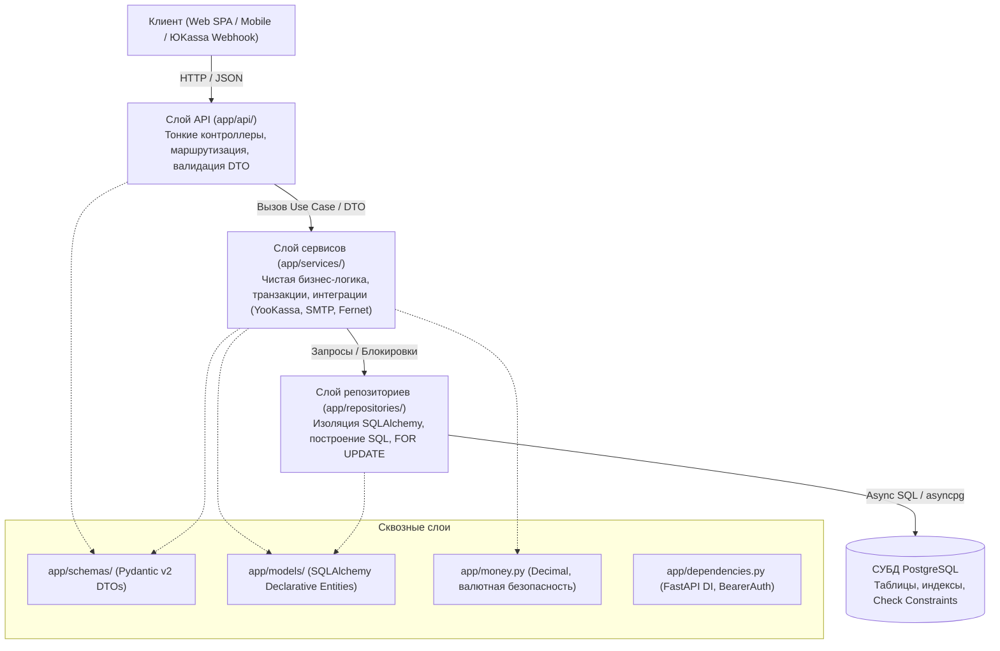
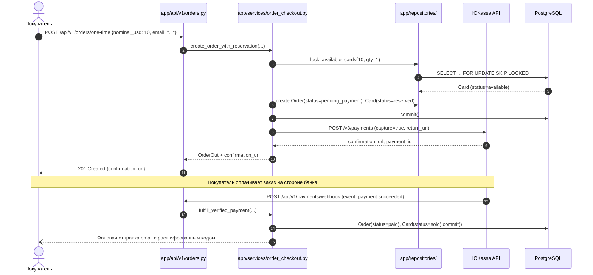

# Архитектура бэкенда «Окно в Европу» (AWE)

Документ описывает архитектурные принципы, структуру слоёв и инженерные решения бэкенда сервиса продажи карт Apple Gift Cards и регулярных подписок. Документ служит практическим руководством для команды и обоснованием проектных решений для защиты на контрольных точках (КТ).

---

## 1. Архитектурный стиль: Почему слоистая архитектура?

В проекте принята классическая **трёхзвенная слоистая архитектура (Layered / Clean Architecture)** с явным разделением обязанностей:

### Почему именно «Роуты $\rightarrow$ Сервисы $\rightarrow$ Репозитории», а не ActiveRecord или «Всё в роутах»?

На ранних стадиях проектов на FastAPI часто встречается антипаттерн «Fat Route» (когда подключение к базе, запросы, вызовы сторонних API и бизнес-правила пишутся прямо в функции эндпоинта). Для нашего проекта такой подход был отвергнут по следующим причинам:

1. **Изоляция и независимое тестирование без моков FastAPI:**
   - Сервисы не зависят от веб-фреймворка (в них нет импортов `FastAPI`, `Request`, `HTTPException`).
   - Бизнес-логику (списание подписки, проверку пароля, расчёт даты биллинга, шифрование кода карты) можно протестировать быстрыми юнит-тестами без поднятия HTTP-сервера или mock-клиентов HTTPX.
2. **Предотвращение утечки транзакций и гонок (Race Conditions):**
   - Управление транзакцией (`session.commit()`, `session.rollback()`) сосредоточено в конкретном юзкейсе сервиса.
   - База данных не может оказаться в полуразобранном состоянии: создание заказа и перевод карты со склада в статус `sold` происходят строго в рамках одного атомарного коммита.
3. **Строгий контроль над SQL и отсутствие проблемы N+1:**
   - Репозитории инкапсулируют все обращения к базе через SQLAlchemy 2.0. Роуты не могут случайно выполнить ленивую загрузку (lazy load) в цикле сериализации JSON.
   - Сложные запросы со строчными блокировками (`FOR UPDATE SKIP LOCKED` при резервировании подарочных карт) изолированы в специализированных методах репозитория и не размазаны по кодовой базе.
4. **Параллельная работа нескольких разработчиков без merge-конфликтов:**
   - Разработчик сервисов может писать доменную логику по согласованному интерфейсу до того, как завершён роут или сверстан финальный DTO.

---

## 2. Границы и ответственность слоёв

### 2.1. Слой представления и маршрутизации (`app/api/`)
* **Назначение:** Тонкий транспортный адаптер протокола HTTP.
* **Что делает:**
  - Принимает входящий запрос, парсит путь, query-параметры и заголовки.
  - Валидирует тело запроса через входные Pydantic-схемы (`app/schemas/`).
  - Внедряет зависимости через `Depends` (`AsyncSession`, `CurrentUser`, `Settings`).
  - Вызывает соответствующий метод доменного сервиса.
  - Транслирует доменные исключения сервиса в стандартизированные HTTP-ответы (`400`, `401`, `403`, `404`, `409`, `422`, `503`).
  - Возвращает выходной DTO (`response_model`).
* **Что запрещено:**
  - Выполнять прямые SQL-запросы (`select`, `execute`).
  - Обращаться к внешним HTTP-сервисам (ЮKassa, SMTP).
  - Принимать бизнес-решения (например, решать, списывать ли деньги или отправлять ли email).
  - Превышать размер функции в 15–20 строк.

### 2.2. Слой доменной логики и сценариев (`app/services/`)
* **Назначение:** Ядро бизнес-логики приложения (Use Cases / Application Services).
* **Что делает:**
  - Реализует конкретные бизнес-сценарии:
    - `auth.py`: регистрация с нормализацией email, аутентификация по bcrypt-хэшу.
    - `tokens.py`: выпуск и верификация асимметричных/симметричных JWT access/refresh токенов.
    - `crypto.py`: симметричное шифрование кодов подарочных карт через Fernet (AES-128-CBC + HMAC-SHA256).
    - `order_checkout.py`: создание разового заказа и предварительное резервирование карт.
    - `order_fulfillment.py`: обработка подтверждённого платежа, перевод карт в `sold`, постановка задач доставки.
    - `recurring_payments.py`: безакцептное списание периода подписки, pre-flight проверка склада, сдвиг даты следующего списания без календарного дрифта.
    - `admin_inventory.py`: валидация и пакетная загрузка пула подарочных карт.
    - `email.py`: асинхронная отправка HTML-писем через Jinja2 и aiosmtplib.
  - Оркестрирует вызовы репозиториев и внешних клиентов.
  - Управляет границами транзакций (`commit` при полном успехе, `rollback` при любой ошибке).
  - Бросает типизированные доменные исключения (например, `RecurringPaymentDeclined`, `GiftCardCryptoError`).
* **Что запрещено:**
  - Импортировать `fastapi`, `starlette`, `Request`, `HTTPException`.
  - Зависеть от деталей транспортного протокола (cookies, заголовки, статус-коды).

### 2.3. Слой доступа к данным (`app/repositories/`)
* **Назначение:** Инкапсуляция взаимодействия с СУБД PostgreSQL через SQLAlchemy 2.0 (async).
* **Что делает:**
  - Содержит специализированные методы выборки и мутации данных:
    - `inventory.py`: атомарный захват карт через `with_for_update(skip_locked=True)` для исключения коллизий между параллельными покупками.
    - `subscriptions.py`: выборка подписок на списание `list_active_due_for_billing` и строчная блокировка подписки `get_for_update` с `populate_existing=True`.
    - `orders.py`: постраничная загрузка истории заказов с подсчётом `total` до пагинации.
  - Оптимизирует SQL: выполняет явные `join` и предотвращает N+1 запросы.
* **Что запрещено:**
  - Принимать решения об отправке писем, обращении в банк или проверке бизнес-правил.
  - Неявно коммитить транзакцию внутри метода выборки (коммитом управляет вызывающий сервис).

### 2.4. Модели данных (`app/models/`) и Схемы (`app/schemas/`)
* **`app/models/` (SQLAlchemy Declarative Entities):**
  - Отражают реляционную структуру таблиц базы данных (`users`, `orders`, `gift_cards`, `prices`, `subscriptions`).
  - Задают ограничения на уровне базы данных: внешние ключи `ForeignKey(ondelete="RESTRICT")`, серверные дефолты, индексы (`ix_subscriptions_status_next_billing_at`), ограничения `CheckConstraint`.
* **`app/schemas/` (Pydantic v2 DTOs):**
  - Определяют контракт API (публичные интерфейсы).
  - Строго разделены на входные (`UserRegister`, `RefreshRequest`) и выходные (`TokenResponse`, `OrderHistoryResponse`).
  - Исключают утечку чувствительных данных: поле `password` помечено `writeOnly=True`, код карты расшифровывается только для оплаченных заказов, номер платёжной карты маскируется (`**** 4242`), а `payment_method_id` никогда не возвращается клиенту.

---

## 3. Ключевые архитектурные решения и паттерны

### 3.1. Финансовая точность: Money Pattern (`app/money.py`)
Плавающая точка (`float`) в финансовых вычислениях категорически запрещена из-за ошибок округления стандарта IEEE 754.
- Все денежные суммы в рублях представлены типом `Decimal` с квантованием до 2 знаков после запятой (`0.01`).
- В моделях БД используется тип `Numeric(12, 2)`.
- Имена полей явно содержат суффикс валюты (`price_rub`, `total_amount_rub`, `sale_price_rub`).
- Для интеграции с ЮKassa используется утилита `decimal_to_yookassa_rub`, форматирующая сумму в строковый формат `"1500.00"`.

### 3.2. Безопасность кодов карт: Fernet-шифрование (`app/services/crypto.py`)
Подарочные карты являются прямым финансовым эквивалентом. Хранение кодов активации в открытом виде в БД недопустимо.
- Коды шифруются алгоритмом **Fernet** (AES-128 в режиме CBC с PKCS7-паддингом и аутентификацией HMAC-SHA256).
- Ключ шифрования `FERNET_KEY` передаётся исключительно через переменные окружения и не хранится в коде или базе.
- Расшифровка кода происходит «just-in-time» непосредственно перед отправкой письма покупателю или при запросе истории заказов в личном кабинете авторизованным пользователем.

### 3.3. Конкурентность и защита от двойных трат (Concurrency Control)
1. **Резервирование карт (`lock_available_cards`):**
   - Используется `SELECT ... FOR UPDATE SKIP LOCKED`.
   - Если два покупателя одновременно покупают карту одного номинала, СУБД блокирует строки независимо: каждый процесс мгновенно захватывает свою карту без взаимных блокировок (deadlocks) и ожидания.
2. **Pre-flight проверка склада при автосписании подписки:**
   - Перед отправкой запроса на безакцептное списание в ЮKassa сервис блокирует карту на складе и проверяет читаемость шифртекста кодов.
   - Если карт нет в наличии или ключ шифрования повреждён, транзакция откатывается **до** обращения к банку. Покупатель не может оказаться в ситуации, когда деньги списаны, а выдать карту невозможно.
3. **Идемпотентность платежей:**
   - Для разовых заказов: `Idempotence-Key = uuid5(NAMESPACE_URL, f"order:{order_id}")`.
   - Для регулярных подписок: `Idempotence-Key = uuid5(NAMESPACE_URL, f"subscription:{id}:{UTC_DATE}")`.
   - Повторные запросы или сбои сети в течение суток обращаются к тому же платежу в ЮKassa, исключая дублирующие списания.

### 3.4. Отсутствие дрифта календарного биллинга
При автопродлении подписки дата следующего платежа рассчитывается не от времени фактического запуска воркера (`datetime.now()`), а от плановой даты предыдущего периода:
$$\text{next\_billing\_at} = \text{previous\_next\_billing\_at} + 30\text{ days}$$
Это предотвращает «расползание» даты ежемесячного списания, если фоновый планировщик отработал с задержкой из-за нагрузки или перезапуска сервиса.

---

## 4. Схема потоков данных (Data Flow)

### 4.1. Сквозной поток разовой покупки

---

## 5. Документация и версионирование API

- Все публичные эндпоинты версионируются через префикс `/api/v1/`.
- Документация OpenAPI 3.1 генерируется автоматически и доступна по адресу `/docs` (Swagger UI) и `/redoc`.
- Для интерактивного тестирования в Swagger UI настроена схема авторизации `BearerAuth` (JWT), позволяющая тестировать закрытые эндпоинты личного кабинета прямо из браузера.
- Все DTO снабжены реалистичными примерами (`examples`) и описаниями (`description`), а поля паролей маскируются с помощью атрибута `writeOnly: True`.
